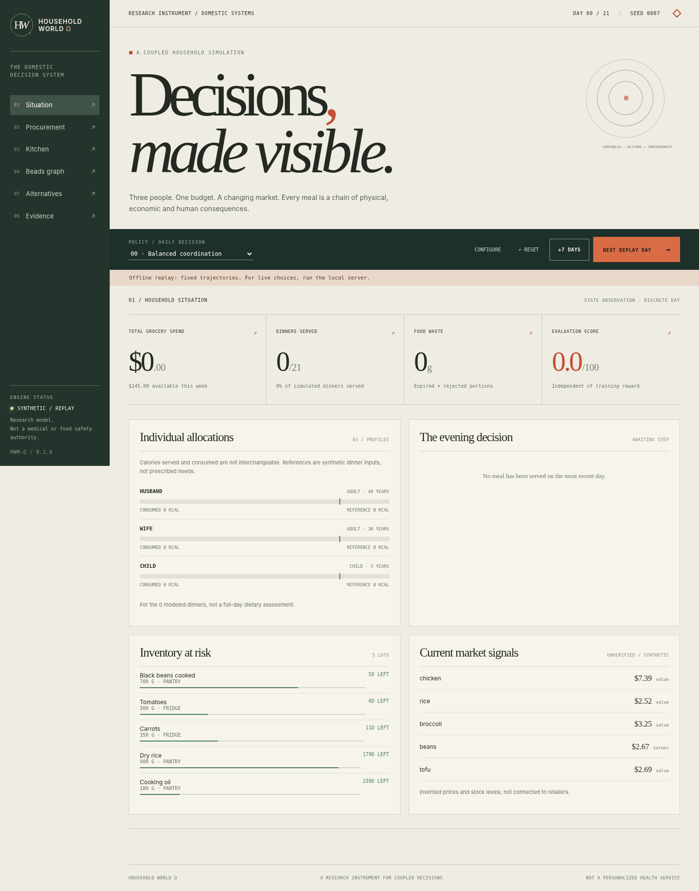

# Household World Ω

**A reproducible household decision laboratory: grocery economics × person-specific dinner allocation × perishable inventory × resource-constrained cooking × typed Beads DAG × reinforcement learning.**



This is a **working research prototype**, not an autonomous shopping service, a medically certified meal planner, a validated kitchen safety model, or an upstream-integrated trained PufferLib agent. The bundled prices, household ages, preferences, product data, and nutrition reference values are explicitly **synthetic fixtures**. It makes no purchases and accesses no external accounts. The simulator models **one shared dinner per day**, not total daily nutrient intake.

## Run now

Python 3.10+, with PyTorch optional. The Python simulator has no mandatory third-party dependencies.

```sh
python -m household.cli simulate --seed 7 --days 30 --action LOW_WASTE
python -m household.cli simulate --seed 7 --days 14 --action BALANCED --output artifacts/sample-trajectory.json
python -m household.cli benchmark --steps 1000
```

**Live local browser:**

```sh
python -m pip install -e '.[web]'
python -m household.cli serve --port 8765
# Open http://127.0.0.1:8765
```

**Offline, completely self-contained preview:** open [`artifacts/preview.html`](artifacts/preview.html) locally in a browser. It contains eight **recorded** 21-day synthetic policy trajectories. It does **not** execute new policy actions; the local API is needed for open-ended interaction.

**Tests and native C:**

```sh
python -m pip install -e '.[test]'
python -m pytest -q
bash scripts/build_native.sh
```

**Train and compare a small CPU PPO policy:**

```sh
python -m pip install -e '.[rl]'
python -m household.cli train --updates 70 --envs 6 --days 12 --seed 17
python -m household.cli evaluate --days 30 --seeds 12 \
  --checkpoint artifacts/household_ppo.pt --output artifacts/my-evaluation.json
```

The provided checkpoint was trained locally. It **does not demonstrate improvement** over the low-waste scripted baseline. See `artifacts/final-heldout.json` and [docs/EVIDENCE.md](docs/EVIDENCE.md).

## What runs

| System | Implemented behavior | Fidelity boundary |
| --- | --- | --- |
| Household | Configurable household members via API and dashboard modal; synthetic husband/wife/child fixture; per-person dinner reference, preference, allergen and texture restrictions | Reference targets must be externally supplied and appropriately reviewed; no medical inference |
| Markets | 3 merchants; 16 food products; exogenous seeded offers, prices, promotions, stockouts and finite availability | Invented prices; no retailer connection, checkout or tax jurisdiction model |
| Transactions | Joint-basket store costs, package quantities, BOGO/percentage/threshold offers, loyalty logic, tax rate, weekly budget cap | Small basket enumeration with fallback; not enterprise retail optimization |
| Food inventory | Purchased/opening lot ledgers, FEFO consumption, expiration, freezing, prepared leftovers, gram conservation | Simplified storage conditions and decay; no temperature-history spoilage kinetics |
| Menu selection | 8 sample recipes; allergen screen; portion allocation; heterogeneous preference and acceptance | One dinner per day; no complete nutrient adequacy or clinical food-safety validation |
| Kitchen | Typed operation DAG, resource-capacity list scheduler, makespan and critical-path bound | No concurrent human actor model or stochastic hands-on labor |
| Physical process | Reduced-order temperature, moisture and energy proxy; native C test kernel | Not calibrated against real foods, pathogen lethality or regulatory guidelines |
| Beads | Dynamic, typed 70–100+ node plan for typical dinners, provenance, dependencies, statuses and event log | Execution-status projection; node handlers are currently pass-through, not individually committed physical transactions |
| RL | Partially observed vector, 8 macro-actions, deterministic replay, CPU PPO baseline, eight scripted policies, bootstrapped policy comparison | Model learns among eight menu/basket policy heuristics, not arbitrary shopping/cooking actions |
| Interface | Local FastAPI and editorial desktop/mobile UI with Beads inspector, market, timeline, counterfactuals, recorded replay export | Offline HTML is a replay, not a live simulator |
| PufferLib | Reduced-fidelity C Ocean header following **PufferLib 5.0 Minimal** interface; CPU stub smoke test | Not compiled against the full upstream checkout; CUDA training not run |

## Architectural map

```text
                       HOUSEHOLD / PEOPLE / SCHEDULES
                                   │
 SYNTHETIC STORES ─── OFFERS ─── PROCUREMENT CHOICE ─── LEDGER
                                   │                      │
                                 BASKET                MONEY
                                   │
                              LOT INVENTORY
                                   │
                           RECIPE / PORTIONS
                                   │
                              BEADS COMPILER
                                   │
                  OPERATION DAG ── SCHEDULER ── THERMAL MODEL
                                   │
                      CONSUMPTION / WASTE / EVENT LOG
                                   │
                     REWARD  +  INDEPENDENT SCORE
                                   │
                   SCRIPTED POLICIES  ↔  CPU PPO
```

The **Beads DAG** encodes work and precedence; the world simulator owns economic, inventory, and physical transitions. The graph must never be mistaken for a full causal physics engine. See [docs/ARCHITECTURE.md](docs/ARCHITECTURE.md), [docs/WORK_GRAPH.md](docs/WORK_GRAPH.md), and [docs/ontology.yaml](docs/ontology.yaml).

## API

| Method | Route | Purpose |
| --- | --- | --- |
| GET | `/api/state` | Current state and observables |
| POST | `/api/configure` | Set synthetic household profiles, budget, horizon and burners |
| POST | `/api/step` | Commit exactly one policy action/day |
| POST | `/api/run` | Commit up to 30 days of one policy |
| POST | `/api/reset` | Reset seeded episode |
| GET | `/api/counterfactual` | Clone world at current state and evaluate all eight next actions |
| GET | `/api/export` | Export current evidence and state |

Example change to budget and members:

```sh
curl -s http://127.0.0.1:8765/api/configure \
  -H 'Content-Type: application/json' \
  -d '{"seed":17,"horizon":28,"weekly_budget_cents":15500,"burners":2,
       "people":[
         {"id":"husband","role":"adult","age_years":40,"dinner_energy_reference_kcal":750,"dinner_protein_reference_g":35,"dinner_fiber_reference_g":8},
         {"id":"wife","role":"adult","age_years":38,"dinner_energy_reference_kcal":650,"dinner_protein_reference_g":28,"dinner_fiber_reference_g":8},
         {"id":"child","role":"child","age_years":3,"dinner_energy_reference_kcal":400,"dinner_protein_reference_g":15,"dinner_fiber_reference_g":4}
       ]}'
```

These are **fictional example inputs**. Do not use them as recommendations for actual adults or children.

## Native PufferLib 5.0 integration path

The source API was inspected from the official [PufferLib 5.0 Minimal environment](https://github.com/PufferAI/PufferLib/tree/5.0/ocean/minimal) and [`src/pufferenv.h`](https://github.com/PufferAI/PufferLib/blob/5.0/src/pufferenv.h). **This runtime could not resolve `github.com`, so an actual upstream `git clone` and full compatibility build could not be completed here.** A source-informed Ocean C header is included, plus a local stub-compiled smoke test.

On a networked workstation with the PufferLib dependencies:

```sh
bash scripts/install_in_puffer.sh /path/to/PufferLib
cd /path/to/PufferLib
./build.sh household --cpu
```

The installer clones tag/branch `5.0` if no checkout exists. It only copies the reduced-fidelity `ocean/household/household.h`; it does **not** install the full Python world as a PufferLib trainer backend. Do not assume the reduced C environment and the Python environment produce the same transition distribution. CPU PPO in this repository is a standalone PyTorch implementation. Full native PuffeRL training and parity verification are outstanding.

## File structure

```text
household/     Python world dynamics, domain types, pricing, inventory, cooking, Beads, RL, API
web/           Local interactive application with household configuration source
artifacts/     Standalone preview, actual browser screenshots, PPO weights, run evidence
native/        Compilable thermal C kernel + reduced Ocean smoke-test stub
 ocean/        Ocean-compatible C environment header (integration not yet proven)
 tests/        66 automated deterministic + end-to-end API and RL tests
 scripts/      Native build, browser checks, upstream install, backlog inspection
 planning/     Development Beads DAG with implement/verify/research statuses
 docs/         Architecture, model limits, ontology, task hierarchy and evidence
 vendor/       Attribution to inspected upstream reference source
```

## Scientific integrity

- Every default data item is `synthetic_fixture` or `simulated` in provenance; no market-price or medical accuracy claim is made.
- Budget and inventory invariants are enforced on every world step; individual nutritional **adequacy** is not certified.
- Food safety is a recipe allergen/texture screen only; the temperature number is an educational proxy, **not a safe-to-eat signal**.
- The held-out evaluation metric is independent of the reward's calculation, but one still needs independent simulator validation to claim external usefulness.
- Price samples, rewards and policy outcomes are reproducible by seed. Stochastic acceptance is synthetic, not a model of real child behavior.
- See the typed roadmap for incomplete, blocked and research-only features rather than inferring them from the broad ontology.

**License:** MIT for original code in this repository. Upstream PufferLib remains independently licensed and is not vendored as a complete checkout. Source attribution: [PufferAI/PufferLib](https://github.com/PufferAI/PufferLib).
